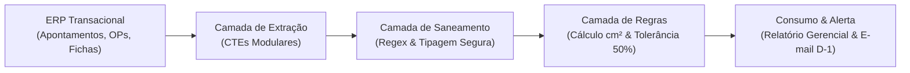

🌐 **Idioma / Language:** [🇧🇷 Português](README.md) | [🇺🇸 English](README.en.md)

# 🏭 Auditoria Automatizada de Consumo de Clichês por Ordem de Produção

Solução analítica em **Oracle SQL** desenvolvida para auditar o consumo de insumos de pré-impressão (clichês flexográficos) em Ordens de Produção (OPs) de produtos acabados, confrontando o apontamento real de chão de fábrica com o cálculo teórico de engenharia e automatizando o envio diário de alertas por exceção.

---

## 📌 O Desafio de Negócio

Em operações industriais de impressão e embalagem, clichês representam um insumo de alto valor unitário. Sem um mecanismo automatizado de validação entre o apontamento de chão de fábrica e os parâmetros técnicos da Ordem de Produção, a operação enfrentava três gargalos críticos:

* **Falta de Visibilidade de Desperdício:** Apontamentos duplicados, refações não justificadas ou erros de digitação passavam despercebidos no fechamento das OPs.
* **Divergência Dimensional:** O consumo real apontado em centímetros quadrados ($\text{cm}^2$) não era confrontado sistematicamente com o desenvolvimento real do cilindro de impressão e a largura do substrato.
* **Sobrecarga Operacional na Análise:** Auditar manualmente centenas de OPs diárias inviabilizava a atuação preventiva da equipe de pré-impressão antes do faturamento ou encerramento do lote.

---

## 🎯 Objetivos da Solução

* **Padronizar o Cálculo Teórico de Engenharia:** Determinar o consumo previsto ($\text{cm}^2$) cruzando a circunferência real do cilindro ($Z \times 3,175$), a largura do material base e o número de cores da arte.
* **Estabelecer Governança por Tolerância:** Aplicar uma margem máxima aceitável de **+50% sobre o previsto**, classificando automaticamente cada OP como *"Dentro da tolerância"* ou *"Acima da tolerância"*.
* **Medir Acuracidade de Apontamento:** Disponibilizar visão comparativa (*Previsto vs. Tolerância vs. Realizado*) e variação percentual para monitoramento contínuo de eficiência.
* **Viabilizar Alertas Ativos por Exceção (D-1):** Estruturar filtros otimizados para disparar relatórios diários contendo exclusivamente as OPs fora do padrão apontadas no dia anterior, reduzindo o ruído operacional.

---

## 📐 Arquitetura e Linhagem de Dados

A pipeline SQL foi projetada seguindo o conceito de transformação em camadas lógicas via **Common Table Expressions (CTEs)** encadeadas, garantindo isolamento de granularidade antes do cruzamento final:

1. **Extração Modular (`lista_op`, `cte_cilindro`, `cte_cores`, `cte_largura_material`):** Cada domínio técnico é agregado separadamente em sua granularidade nativa (OP) antes dos `JOINs`, evitando produto cartesiano e multiplicação indevida de volumes.
2. **Saneamento e Tipagem (`base_calculo`):** Atributos dinâmicos armazenados como texto (`VARCHAR2`) passam por higienização com expressões regulares antes da conversão numérica.
3. **Motor de Regras (`calculo_final`):** Executa a conversão de unidades ($\text{mm}^2 \rightarrow \text{cm}^2$), aplica o multiplicador de tolerância ($1,5\times$) e gera as flags de auditoria.

---

## 🛠️ Engenharia e Solução Técnica

* **Prevenção de Produto Cartesiano:** Como uma OP possui múltiplos componentes (tintas, substratos) e acessórios, as agregações (`SUM`, `COUNT`, `MAX`) foram isoladas em CTEs dedicadas antes da junção com a ficha técnica do produto acabado.
* **Blindagem contra Erros de Conversão (`ORA-01722`):** Parâmetros técnicos de engenharia (largura de substrato e circunferência de cilindro) frequentemente residem em campos textuais sujeitos a formatações mistas (vírgulas decimais, pontos de milhar ou caracteres residuais). A solução implementa `REGEXP_REPLACE` combinado com `NLS_NUMERIC_CHARACTERS` e `NULLIF` para garantir resiliência total em produção.
* **Fidelidade Dimensional ao Processo Fabril:** Em vez de utilizar apenas a altura nominal do produto acabado, a query prioriza a **circunferência real do cilindro** vinculada à OP, refletindo com precisão a área efetiva de gravação do clichê.
* **Filtro de Alta Seletividade:** A geração da flag binária `filtro_auditoria` (`'A'` / `'D'`) permite que rotinas agendadas de e-mail filtrem apenas exceções sem reprocessar regras complexas na camada de apresentação.

---

## 🚀 Impacto no Negócio

* **Detecção Proativa de Desvios:** Identificação imediata de consumos anômalos logo no dia seguinte ao apontamento (D+1), permitindo correção de apontamentos ou investigação de falhas de gravação em tempo hábil.
* **Foco na Exceção (Redução de Ruído):** A equipe de pré-impressão analisa apenas as OPs que ultrapassaram o teto de 50%, otimizando o tempo de análise técnica.
* **Indicador Confiável de Acuracidade:** Criação de uma linha de base auditável entre engenharia de produto e apontamento de chão de fábrica, fortalecendo o controle de custos industriais.

---

📖 Para detalhes de execução, parâmetros e dicionário de dados, acesse o [Guia do Usuário](docs/user_guide.md).
